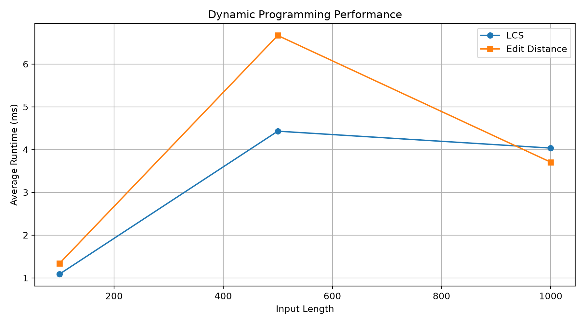
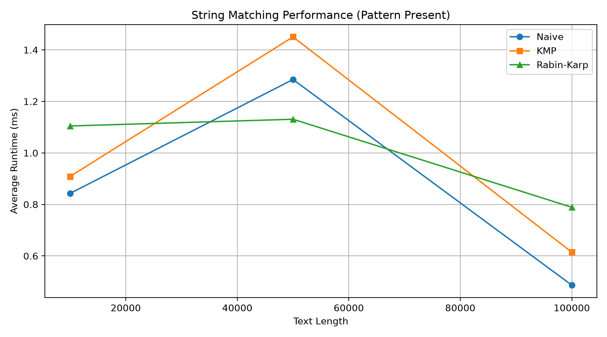

# Assignment 4 — Text Analysis: Dynamic Programming and String Algorithms

## 1. Project Overview

This project implements and evaluates six algorithms used in text analysis, dynamic programming, pattern matching, and suffix processing.

The project was developed in Java using IntelliJ IDEA.

### Implemented Algorithms

1. Longest Common Subsequence (LCS)
2. Edit Distance (Levenshtein Distance)
3. Naive String Matching
4. Knuth–Morris–Pratt (KMP)
5. Rabin–Karp
6. Kasai's Longest Common Prefix (LCP) Algorithm

The main objectives are to implement these algorithms, verify their correctness, analyze their theoretical complexity, and compare their practical execution times.

## 2. Implementation and Design Decisions

### 2.1 Longest Common Subsequence (LCS)

LCS finds the length of the longest subsequence shared by two strings while preserving character order.

The implementation uses a two-dimensional dynamic programming table. When characters match, the diagonal value is increased by one. Otherwise, the maximum of the previous row and column is selected.

### 2.2 Edit Distance

Edit Distance calculates the minimum number of insertions, deletions, and substitutions required to transform one string into another.

The implementation uses a two-dimensional dynamic programming table. Each cell stores the minimum edit cost for the corresponding string prefixes.

All three edit operations have a cost of one.

### 2.3 Naive String Matching

Naive String Matching checks every possible starting position in the text and compares the pattern character by character.

It is simple to implement but may perform repeated comparisons.

### 2.4 Knuth–Morris–Pratt (KMP)

KMP improves pattern matching by preprocessing the pattern into a Longest Proper Prefix which is also Suffix (LPS) array.

When a mismatch occurs, the LPS array helps avoid unnecessary comparisons.

### 2.5 Rabin–Karp

Rabin–Karp uses a rolling hash to compare the pattern against text windows.

The implementation uses:

- Hash base: 256
- Modulus: 1,000,000,007
- Character-by-character verification after hash matches

Verification prevents incorrect matches caused by hash collisions.

### 2.6 Kasai's Algorithm

Kasai's algorithm calculates the Longest Common Prefix array from a text and its suffix array.

It uses a rank array and reuses previous prefix comparisons to calculate LCP values efficiently.

The suffix array is provided as input to the algorithm. In the benchmark, suffix array construction is performed separately and excluded from the timed Kasai operation.

## 3. Assumptions

- String matching returns zero-based starting positions.
- An empty pattern matches at every boundary, including the position after the final character.
- Matching results are returned in ascending order.
- The algorithms operate on Java strings.
- Benchmark input strings use the alphabet `ABCD`.
- Random input generation uses seed `42`.
- All algorithms are executed locally using Java.
- Input generation and file writing are excluded from measured execution time.

## 4. Theoretical Complexity Analysis

Let:

- `n` = text length or first string length
- `m` = pattern length or second string length

| Algorithm | Best Time | Worst Time | Auxiliary Space |
|---|---|---|---|
| LCS | O(nm) | O(nm) | O(nm) |
| Edit Distance | O(nm) | O(nm) | O(nm) |
| Naive Matching | O(n) for fixed m | O(nm) | O(1) excluding output |
| KMP | O(n + m) | O(n + m) | O(m) excluding output |
| Rabin–Karp | O(n + m) | O(nm) | O(1) excluding output |
| Kasai | O(n) | O(n) | O(n) |

For Naive Matching, the best case is more generally O((n − m + 1)) for valid pattern lengths, while the worst case occurs when many characters are repeatedly compared.

Rabin–Karp can have quadratic worst-case behavior because hash collisions require character-by-character verification.

Kasai's complexity assumes that a valid suffix array has already been supplied.

## 5. Correctness Testing

Correctness tests were created in `tests/AlgorithmTests.java`.

### LCS Tests

The tests cover:

- Identical strings
- Completely different strings
- Empty first string
- Empty second string
- Normal subsequences

### Edit Distance Tests

The tests cover:

- Identical strings
- Empty strings
- Substitution
- Insertion
- Deletion
- Multiple edit operations

### String Matching Tests

Naive, KMP, and Rabin–Karp are tested using the same inputs.

The test cases include:

- Pattern at the beginning
- Pattern in the middle
- Pattern at the end
- Multiple occurrences
- Overlapping occurrences
- Pattern not found
- Pattern longer than text
- Empty pattern
- Identical text and pattern
- Empty text

All three algorithms are checked against the expected matching positions.

### Kasai Tests

Kasai's algorithm is tested using manually verified suffix arrays and expected LCP arrays.

Examples include:

- `banana`
- `aaaa`
- `abcd`
- Single-character strings
- Empty strings

The automated test program contains 28 test cases.

## 6. Experimental Methodology

The experiments were implemented in `src/experiments/Benchmark.java`.

### Experimental Configuration

| Parameter | Value |
|---|---|
| Programming language | Java |
| Development environment | IntelliJ IDEA |
| Random seed | 42 |
| Input alphabet | ABCD |
| Timed runs | 5 |
| Timing method | System.nanoTime() |
| Reported unit | Milliseconds |
| Aggregation | Arithmetic mean |

Each experiment is measured five times, and the average execution time is reported.

Input generation, printing, suffix array construction, and CSV writing are excluded from the timed operations.

For string matching, the same text and pattern are used across Naive, KMP, and Rabin–Karp.

The matching experiments include both present and absent patterns.

The results are stored in the `results` directory.

## 7. Experimental Results

### 7.1 Dynamic Programming Performance

Input sizes: 100, 500, and 1,000 characters.

| Input Size | LCS (ms) | Edit Distance (ms) |
|---|---:|---:|
| 100 | 1.0861 | 1.3352 |
| 500 | 4.4296 | 6.6674 |
| 1000 | 4.0346 | 3.7048 |



Both algorithms use two-dimensional dynamic programming tables, so their theoretical time complexity is O(nm).

The measured runtime increased between input sizes 100 and 500, but decreased at 1,000. This non-monotonic behavior may reflect JVM warm-up, JIT compilation, garbage collection, and timing variability.

These measurements are not sufficient to establish a consistent practical speed advantage for either algorithm.

### 7.2 String Matching Performance

Input sizes: 10,000, 50,000, and 100,000 characters.

#### Pattern Present

| Text Size | Naive (ms) | KMP (ms) | Rabin–Karp (ms) |
|---|---:|---:|---:|
| 10000 | 0.8427 | 0.9086 | 1.1046 |
| 50000 | 1.2851 | 1.4505 | 1.1307 |
| 100000 | 0.4865 | 0.6146 | 0.7890 |

#### Pattern Absent

| Text Size | Naive (ms) | KMP (ms) | Rabin–Karp (ms) |
|---|---:|---:|---:|
| 10000 | 0.2762 | 0.3044 | 0.2037 |
| 50000 | 0.5513 | 0.4366 | 0.4339 |
| 100000 | 0.1434 | 0.2462 | 0.8830 |



The graph compares the three algorithms for the pattern-present cases.

The experiments show that no algorithm was consistently fastest across every input size.

Naive matching performed well in several measurements. KMP avoids repeated pattern comparisons through preprocessing, while Rabin–Karp uses rolling hashes and verification.

The pattern length was fixed at 10 characters, and the alphabet contained four characters. These conditions can influence practical performance.

The results also show timing variability, so a larger benchmark with JVM warm-up and additional repetitions would be useful for more reliable conclusions.

### 7.3 Kasai Performance

Input sizes: 1,000, 5,000, and 10,000 characters.

| Input Size | Kasai (ms) |
|---|---:|
| 1000 | 0.2777 |
| 5000 | 0.9082 |
| 10000 | 0.3797 |

Kasai's algorithm has O(n) time complexity when the suffix array is already available.

The measured time increased from 1,000 to 5,000 characters, then decreased at 10,000 characters.

This variation may result from JVM optimization and runtime measurement noise. The results do not contradict the theoretical linear-time complexity.

## 8. Discussion

The experiments demonstrate the difference between theoretical complexity and observed runtime.

Dynamic programming algorithms require O(nm) time and memory because they construct tables based on both input lengths.

KMP provides linear worst-case matching time, making it suitable for avoiding repeated comparisons in long texts.

Rabin–Karp uses hashing, which can be useful in pattern matching, but hash verification introduces additional work.

Naive matching can still perform competitively for short patterns and favorable input data despite its weaker worst-case complexity.

Kasai efficiently calculates LCP values when a suffix array is available.

The results are affected by the Java Virtual Machine, including compilation and runtime optimization. The benchmark does not include a separate warm-up phase, and the algorithms are measured in a fixed order.

Therefore, the measured values should be interpreted as experimental observations rather than definitive rankings.

## 9. Project Structure

```text
Assignment-4/
├── src/
│   ├── dp/
│   │   ├── LCS.java
│   │   └── EditDistance.java
│   ├── matching/
│   │   ├── NaiveSearch.java
│   │   ├── KMP.java
│   │   └── RabinKarp.java
│   ├── suffix/
│   │   └── Kasai.java
│   └── experiments/
│       └── Benchmark.java
├── tests/
│   └── AlgorithmTests.java
├── results/
│   ├── dp_results.csv
│   ├── matching_results.csv
│   └── kasai_results.csv
├── plots/
│   ├── dp_performance.png
│   └── matching_performance.png
├── plot_results.py
└── README.md
```

## 10. How to Run

### Run Correctness Tests

1. Open the project in IntelliJ IDEA.
2. Open `tests/AlgorithmTests.java`.
3. Run the `main()` method.
4. Review the test results in the console.

### Run Benchmarks

1. Open `src/experiments/Benchmark.java`.
2. Run the `main()` method.
3. The program measures algorithm execution times.
4. The CSV results are saved in the `results` folder.

### Generate Performance Graphs

Python and Matplotlib are required for graph generation.

Install Matplotlib:

```bash
python -m pip install matplotlib
```

Run the plotting script from the project root:

```bash
python plot_results.py
```

The generated graphs are saved in the `plots` folder.

## 11. Conclusion

This assignment implemented six important algorithms for text analysis and string processing.

Correctness testing was designed to verify expected behavior across normal cases, boundary conditions, and special inputs.

The experimental evaluation compared algorithm execution times using fixed random inputs, repeated measurements, and recorded results.

The results demonstrate that theoretical time complexity is essential for understanding scalability, while practical performance can also depend on implementation details, input characteristics, and the runtime environment.

The project provides a foundation for understanding dynamic programming, efficient string matching, and suffix-based text processing.